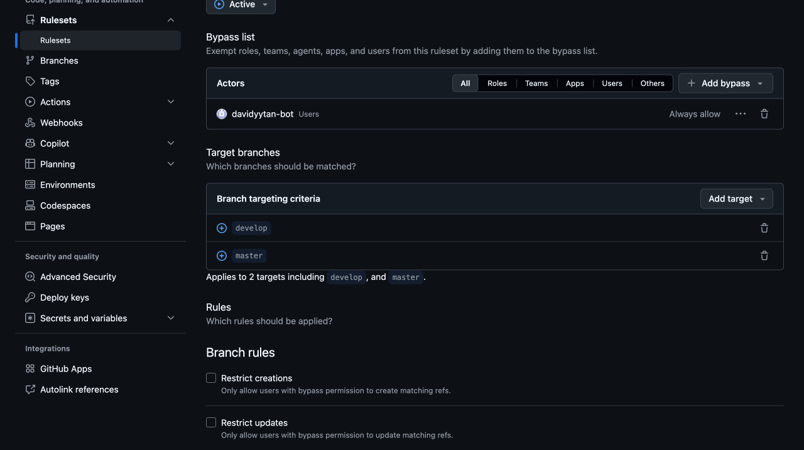
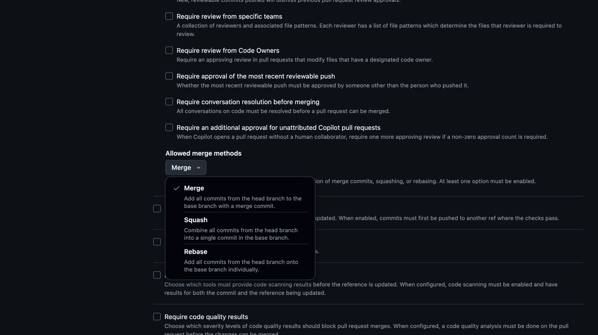

# 1. PR-only develop and master

[Policy index](README.md) · [Next: history protection](02-history-protection.md)

**Purpose:** require human changes to `develop` and `master` to arrive through PRs, using merge commits. The dedicated automation account may make ordinary direct publication pushes. This baseline requires **zero approvals**, as used by the solo-developer preset. [Policy 4](04-allowed-mergers.md) restricts who may merge; optional [policy 3](03-independent-review.md) adds independent review when another eligible reviewer is available.

These are generic configuration instructions. Inspect existing policies first and edit intentionally rather than creating a duplicate.

## Browser steps

1. Open **Settings → Rulesets → Rulesets → New ruleset → New branch ruleset**.
2. Enter **Ruleset Name:** `PR-only develop and master`.
3. Choose **Enforcement status → Active** when ready.
4. Under **Bypass list**, click **Add bypass**.
5. Search your dedicated automation account's login in **Filter actors**, then select the exact **Users** entry.
6. Confirm its row shows **Users** and **Always allow**. Do not add the Write/Admin role, all collaborators, or an unrelated app. Do not add humans to this ruleset's bypass list.
7. Under **Target branches**, add `develop` and `master` separately via **Add target → Include by pattern → Branch naming pattern → Add Inclusion pattern**. Confirm both exact includes and no exclusions.

8. Under **Rules**, clear the new form's prechecked **Restrict deletions** and **Block force pushes**. Those protections belong in policy 2, where the bot has no bypass.
9. Check **Require a pull request before merging**. If its options are collapsed, click **Show additional settings**.
10. Set **Required approvals → 0**.
11. Leave all six review checkboxes **unchecked**:
    - **Dismiss stale pull request approvals when new commits are pushed**
    - **Require review from specific teams**
    - **Require review from Code Owners**
    - **Require approval of the most recent reviewable push**
    - **Require conversation resolution before merging**
    - **Require an additional approval for unattributed Copilot pull requests** — this may be preselected on a new form; explicitly clear it.
12. Under **Allowed merge methods**, keep **Merge** checked and clear **Squash** and **Rebase**.
13. Leave every other branch-rule checkbox unchecked, including status checks, signatures, and linear history.
14. Click **Create**. On an existing ruleset, use **Save changes** only if intentionally editing it.

*This saved zero-approval example enforces the PR path without requiring an approving review.*

## Verify

| Item | Expected value |
| --- | --- |
| Enforcement | Active |
| Targets | Exact `develop` and `master`; no exclusions |
| Enabled branch rules | Only **Require a pull request before merging** |
| Required approvals | 0 |
| Optional review checkboxes | All off |
| Allowed merge methods | Merge only |
| Bypass actors | Only the bot user, **Always allow** |

The overview should report **1 branch rule · targeting 2 branches**. A human must use a PR but can merge without review under this baseline. Public visibility does not grant merge access. Existing Write/Admin permission is not an exception to an additional [policy 4 merger allowlist](04-allowed-mergers.md). The bot remains the explicitly authorised automation exception.

The bot bypass is identity-based, not a version-commit-only exemption. It does not override the separate history ruleset. See the [automation caveat](README.md#human-review-and-the-bot-exception).

For Conventional Commit merge subjects, also configure [PR title and description defaults](README.md#merge-commit-title-and-description).
