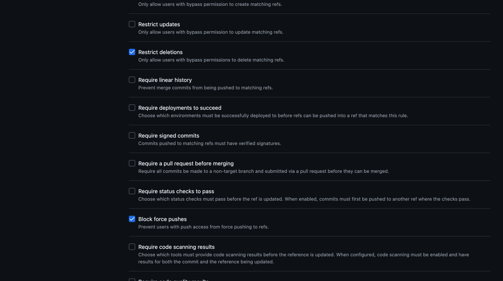

# 2. Protect develop and master history

[Policy index](README.md) · [Previous: PR-only](01-pr-only.md) · [Optional independent review](03-independent-review.md) · [Allowed mergers](04-allowed-mergers.md)

**Purpose:** prevent deletion and non-fast-forward updates of `develop` and `master`. These protections apply to the bot as well as humans.

These are generic configuration instructions. Inspect existing policies first and edit intentionally rather than creating a duplicate.

## Browser steps

1. Open **Settings → Rulesets → Rulesets → New ruleset → New branch ruleset**.
2. Enter **Ruleset Name:** `Protect develop and master history`.
3. Choose **Enforcement status → Active** when ready.
4. Leave **Bypass list** completely **empty**. Do not add the bot, human maintainers, or an Admin/Write role.
5. Under **Target branches**, add `develop` and `master` separately:
   - **Add target → Include by pattern**.
   - Enter the exact branch name in **Branch naming pattern**.
   - Click **Add Inclusion pattern**; repeat for the other branch.
6. Under **Rules**, check **only**:
   - **Restrict deletions**
   - **Block force pushes**
7. Leave all other branch rules unchecked. In particular, do not enable **Restrict updates** here: policy 4 has a different bypass list for that purpose.
8. Click **Create**. For an intentional edit of an existing ruleset, use **Save changes** instead.

The new form currently preselects these two checkboxes, but verify them rather than relying on the defaults.

*Saved example. The empty bypass list and exact targets are above this scrolled part of the form; verify those too.*

## Verify

| Item | Expected value |
| --- | --- |
| Enforcement | Active |
| Targets | Exact `develop` and `master`; no exclusions |
| Enabled rules | **Restrict deletions** and **Block force pushes** only |
| Bypass list | Empty |

The overview should report **2 branch rules · targeting 2 branches**. API rule types are `deletion` and `non_fast_forward`.

A bot with bypass in another ruleset still cannot bypass this one. Normal fast-forward publication pushes remain possible when the bot satisfies or bypasses the other applicable rules. Its actual SSH authentication and publication path still need separate validation.

This rule does not require reviews, restrict PR mergers, or protect tags. Administrators can edit the policy itself; do not interpret an empty bypass list as preventing the owner from changing settings.

Do not test destructive operations on important branches just to demonstrate protection. Inspect configuration and use a disposable repository if an operational test is needed.
