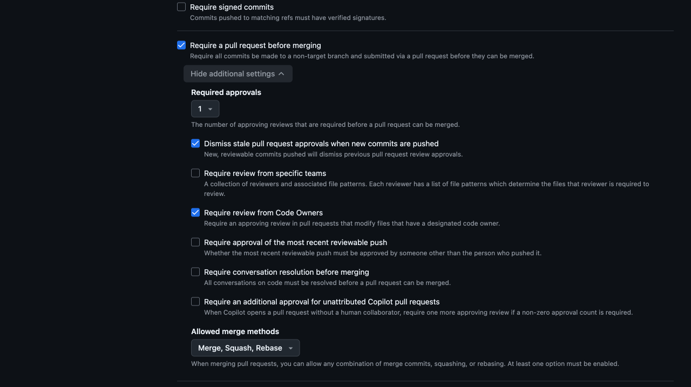

# 3. Independent review required

[Policy index](README.md) · [PR-only baseline](01-pr-only.md) · [History protection](02-history-protection.md) · [Next: allowed mergers](04-allowed-mergers.md)

**Purpose:** require one approving review from an eligible code owner other than the PR author before a human merges into `develop` or `master`. This uses native GitHub required approvals and CODEOWNERS.

**Optional team policy:** skip this policy for the [solo-developer preset](README.md#solo-developer-and-team-presets). GitHub does not let authors approve their own PRs, so independent review requires another eligible person. Policies 1, 2, and 4 can enforce the PR path, protect history, and restrict mergers without requiring a review.

This is a generic configuration guide, not a report of an installed policy. The screenshot is a **partial, unsaved example**. The procedure uses native GitHub settings only.

## How the two-reviewer example works

- Configure two eligible code owners. When one authors a PR, the other can provide the required approval. For another contributor's PR, either owner can approve.
- With both owners on the same catch-all CODEOWNERS line and **Required approvals → 1**, approval by **one** of them is sufficient, not both.
- A qualifying review must be submitted as **Approve**. A comment, **COMMENTED** review, or **Request changes** review is not an approval.
- CODEOWNERS controls whose approval satisfies this gate; it does not prohibit other people from commenting or reviewing where GitHub otherwise permits them.
- Enable stale-approval dismissal so reviewable changes require fresh approval. Inspect the current review state rather than assuming an earlier approval covers a changed diff or merge base.

## Install CODEOWNERS on both target branches first

GitHub reads CODEOWNERS from the PR's **base branch**, not just its source branch. Install the effective file through PRs into **both `develop` and `master` before enabling required Code Owner reviews**.

Example `.github/CODEOWNERS`:

```text
* @reviewer-one @reviewer-two
```

These are **placeholder accounts**. Replace them with your own eligible reviewers before committing the file. Both must have explicit Write or Admin access and be valid code owners. Confirm access in **Settings → Collaborators** or **Collaborators and teams**; public visibility alone is not permission.

### Browser preparation

1. Open **Code** and select `develop`.
2. Inspect existing CODEOWNERS files. GitHub searches `.github/`, the repository root, then `docs/`, using the first matching file location. Reconcile the effective file rather than adding a second, ignored one. Later matching patterns can override earlier entries; check that the intended owners cover the relevant paths, including CODEOWNERS itself.
3. Choose **Add file → Create new file**, enter `.github/CODEOWNERS`, and add your actual owners. If the effective file exists, edit it while preserving or deliberately reconciling its current requirements.
4. Click **Commit changes**, select **Create a new branch for this commit and start a pull request**, and propose the change. Do not directly commit to a protected base.
5. Confirm **base: develop**, review the diff, and merge through your existing authorised PR process. Use the merge method required by your chosen workflow.
6. Select `develop` again and verify that the effective file is present and has no GitHub syntax or owner errors.
7. Repeat through a PR with **base: master**, starting from `master`. Verify the effective file there too; installing it on `develop` does not install it on `master`.
8. Only after both target branches contain valid ownership rules should you enable this review policy. Stop if an owner is invalid or lacks the required access.

## Browser steps for the review ruleset

Inspect existing policies first. Do not create a duplicate or activate a screenshot-only draft.

1. Follow [Open a new branch ruleset](README.md#open-a-new-branch-ruleset).
2. Set **Ruleset Name:** `Independent review develop and master`. Keep **Enforcement status → Disabled** while preparing; activate only when prerequisites are ready and the rollout is authorised.
3. If retaining direct automation publication, add your dedicated automation account under **Bypass list → Add bypass → Filter actors**. Select the exact **Users** entry and use **Always allow**. See the [automation exception](README.md#human-review-and-the-bot-exception).
4. Add **no human bypass**, no Admin/Write role bypass, and no **For pull requests only** human exception to this review gate. Permission to merge under policy 4 must not waive review here.
5. Add the exact `develop` and `master` targets using [Target the exact branches](README.md#target-the-exact-branches). Confirm both includes and no exclusions.
6. Under **Rules**, clear the new form's prechecked **Restrict deletions** and **Block force pushes**. Those belong in policy 2, with no bypass.
7. Check **Require a pull request before merging** and expand **Show additional settings** if needed.
8. Set **Required approvals → 1**.
9. Set the review options exactly as follows:

   | Review option | Selection |
   | --- | --- |
   | **Dismiss stale pull request approvals when new commits are pushed** | **Checked** |
   | **Require review from specific teams** | Unchecked |
   | **Require review from Code Owners** | **Checked** |
   | **Require approval of the most recent reviewable push** | Unchecked |
   | **Require conversation resolution before merging** | Unchecked |
   | **Require an additional approval for unattributed Copilot pull requests** | Unchecked; explicitly clear it if preselected |

10. Leave **Merge**, **Squash**, and **Rebase** selected under **Allowed merge methods** in this separate review ruleset. Other applicable rules and repository settings still restrict the effective methods.
11. Leave every other branch-rule checkbox off, including **Restrict updates**, status checks, signatures, and linear history. This policy adds review; it does not replace policies 1, 2, or 4.
12. For a draft, leave without clicking **Create**. For an authorised rollout after preparing CODEOWNERS and validating the design, choose **Active → Create**. Use **Save changes** only for an intentional edit of an existing ruleset.
13. Reopen any saved ruleset and verify the full form, not just the review section.



*Real GitHub new-ruleset form, unsaved and partial. The image shows review options and broad merge-method selection; it does not establish complete targets, bypasses, CODEOWNERS prerequisites, or successful operation.*

### Why leave last-push approval off?

**Require approval of the most recent reviewable push** is an additional condition, not a synonym for independent review. It can deadlock a two-person flow: one owner authors the PR and the other pushes a review fix, leaving the author unable to approve their own PR and the other owner unable to approve their own latest push. Leave it off for this example. Stale-approval dismissal remains enabled.

### Effective merge methods

Rulesets and repository settings apply together. Although this review ruleset leaves all three merge methods selected, the merge-only [policy 1 example](01-pr-only.md) and [General settings](README.md#merge-commit-title-and-description) still make **Create a merge commit** the only effective method. For squash-based workflows, follow the [mode guide](../actions/README.md#choose-a-flow) instead of copying the merge-only preset unchanged.

## Verify

| Item | Intended configuration |
| --- | --- |
| CODEOWNERS | Valid effective file on both target branches; eligible reviewers |
| Enforcement | Active only for an authorised rollout; a draft stays unsaved/Disabled |
| Targets | Exact `develop` and `master`; no exclusions |
| Enabled branch rule | Only **Require a pull request before merging** |
| Required approvals | 1 |
| Stale-approval dismissal | On |
| Code Owner review | On |
| Other four review options | Off |
| Allowed merge methods in this ruleset | Merge, Squash, Rebase; other settings still apply |
| Bypass | Only the deliberately authorised automation account, if needed; no humans or roles |

The overview should report **1 branch rule · targeting 2 branches**. The count alone does not prove that review is correctly enforced.

The automation exception is identity-wide: **Always allow** can permit bot PR merges as well as direct publication pushes. Do not claim that every merge is independently reviewed when this exception exists. Do not use automation to manufacture an owner's approval. The actual push credential must authenticate as the authorised account; commit author metadata is not proof. [Policy 2](02-history-protection.md) still has no bypass.

## Verification scenarios

These are proposed tests, not reported outcomes. Use a disposable repository or suitable test PRs; do not force-push or delete important branches.

| Scenario | Expected result |
| --- | --- |
| Human PR without approval | Review gate blocks merging |
| One code owner authors the PR | The other eligible owner must approve |
| Another contributor authors the PR | One eligible owner's approval is sufficient |
| Only comments, change requests, or non-owner approval | Does not satisfy the required owner approval |
| New reviewable change after approval | A fresh qualifying approval is needed when the old one is dismissed |
| CODEOWNERS absent from a base branch or invalid | Prerequisite failure; do not claim enforcement there |
| Human is permitted to merge under policy 4 | Still needs the approval required here |
| Automation uses its deliberate bypass | Review may be bypassed; history protection still applies |

Saved settings and screenshots do not prove end-to-end merge or credential tests. These instructions do not themselves create CODEOWNERS, change collaborators, or activate a ruleset.

## References

- [About code owners](https://docs.github.com/en/repositories/managing-your-repositorys-settings-and-features/customizing-your-repository/about-code-owners)
- [Available rules for rulesets](https://docs.github.com/en/repositories/configuring-branches-and-merges-in-your-repository/managing-rulesets/available-rules-for-rulesets)
- [About pull request reviews](https://docs.github.com/en/pull-requests/collaborating-with-pull-requests/reviewing-changes-in-pull-requests/about-pull-request-reviews)
