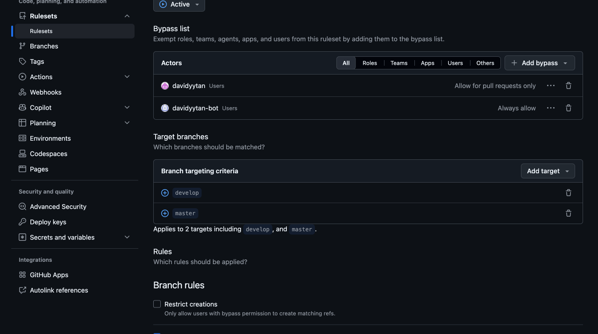
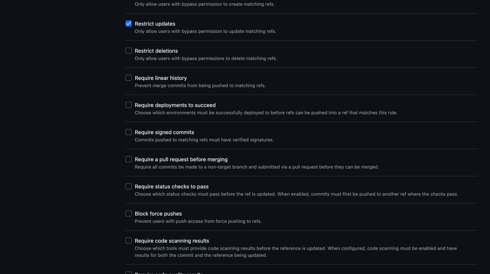

# 4. Allowed mergers for develop and master

[Policy index](README.md) · [Optional independent review](03-independent-review.md) · [PR-only baseline](01-pr-only.md)

**Purpose:** restrict protected-branch merging to an explicit human allowlist while retaining a deliberately authorised automation exception. This separate ruleset contains **Restrict updates only**. It neither grants repository access nor requires review.

For a solo-developer repository, allow the maintainer as the only human merger and use policies **1, 2, and 4**. Policy 3 is optional independent review for repositories with another eligible reviewer. With zero required approvals, the permitted maintainer can merge their own PR without a review.

## Example configuration

| Item | Intended value |
| --- | --- |
| Enforcement | Active after an authorised rollout |
| Targets | Exact `develop` and `master`; no exclusions |
| Enabled branch rule | **Restrict updates** only (`update` in the API) |
| Each permitted human merger | **Users → For pull requests only** |
| Dedicated automation account | **Users → Always allow**, if needed for publication |
| Other users, broad roles, unrelated Apps/teams | No bypass |

*Illustrative saved configuration with one human merger and one automation account. Use your own authorised accounts; the screenshot's identities are not required values.*

## Browser steps

Inspect existing rules first. Edit an existing policy intentionally rather than creating a duplicate.

1. Open **Settings → Rulesets → Rulesets**. Open the applicable existing ruleset or choose **New ruleset → New branch ruleset**.
2. Use **Ruleset Name:** `Allowed mergers develop and master`. Keep a new draft **Disabled** until verified.
3. Under **Bypass list → Add bypass → Filter actors**, find the exact account of the intended human merger. Select its **Users** entry, not an Admin/Write role or an automation account.
4. Open that actor's actions menu and choose **For pull requests only**. The row displays **Allow for pull requests only**. Do not use **Always** or **Exempt** for a human merger in this preset.
5. Repeat only for other deliberately authorised human mergers. For the solo preset, keep exactly one human row.
6. If direct publication requires it, add the dedicated automation account as a **Users** row with **Always allow**.
7. Remove unintended ruleset actors. Removing a bypass row is not the same as removing collaborator access. Do not add all collaborators, broad roles, or unrelated Apps/teams.
8. Add exact `develop` and `master` includes using [Target the exact branches](README.md#target-the-exact-branches). Confirm both targets and no exclusions.
9. Under **Rules**, clear the new form's default **Restrict deletions** and **Block force pushes**, then check **Restrict updates**.
10. Leave every other branch rule off, including **Require a pull request before merging** and status checks. Policy 1 supplies the PR path; policy 2 protects history. Optional policy 3 supplies independent review when desired.
11. Verify the complete form. For an authorised new policy choose **Active → Create**. Use **Save changes** for an intentional edit. Do not save a screenshot-only draft.

*Keep the review requirement separate. A human's PR-only bypass here must not also waive review in the same ruleset.*

The overview should show **1 branch rule · targeting 2 branches**. Check actor modes and individual options as well; the count alone is insufficient.

## Review permission and merge permission are different

- **Policy 4:** determines which otherwise eligible users may merge into the targeted branches.
- **Optional policy 3:** determines whose independent approval is required before an allowed human merger may proceed.
- People outside the merger allowlist may still have Write access or leave comments/reviews; that does not bypass this update restriction.
- A listed actor still needs ordinary repository permission. A bypass is not a permission grant, and public visibility does not confer merge access.

These exact targets do not cover tags, feature branches, `release/*`, or `hotfix/*`. Check the scope required by your workflow separately.

## Automation exception

The human allowlist does not mean no other identity can merge. **Always allow** lets the dedicated automation identity make ordinary publication pushes and can also allow bot PR merges, including human-authored PRs. It is not a version-commit-only or direct-push-only exemption.

The bot needs the relevant exception in policy 1 and, if enabled, policy 3. Its actual credential must authenticate as that account; commit author metadata is not proof. Policy 2 keeps an empty bypass list, including for automation. Administrators can edit the rules themselves.

## Expected outcomes

| Operation on the targeted branches | Solo preset: 1, 2, 4 | Team preset: 1, 2, 3, 4 |
| --- | --- | --- |
| Allowed human merges without review | Permitted if other requirements pass | Blocked until required independent approval |
| Allowed human merges with valid approval | Permitted if other requirements pass | Permitted if all other requirements pass |
| Human outside the merger allowlist tries to merge | Blocked by policy 4 | Blocked even with a valid review |
| Human attempts an ordinary direct push | Blocked by the PR path | Blocked by the PR path |
| Automation publishes or merges a PR | Deliberate identity-based exception may apply | Exception may also bypass independent review |
| Any actor attempts deletion or a non-fast-forward update | No history bypass | No history bypass |

These are configuration expectations, not executed test results. Validate with suitable test PRs and check actual authentication separately. Do not test destructive operations on important branches.
