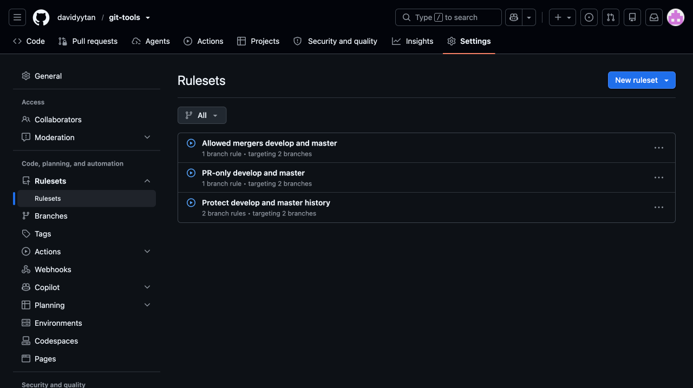
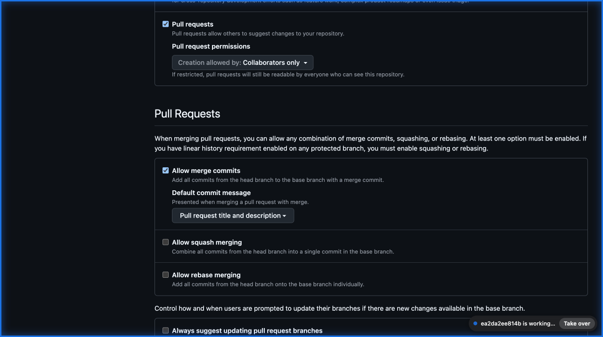
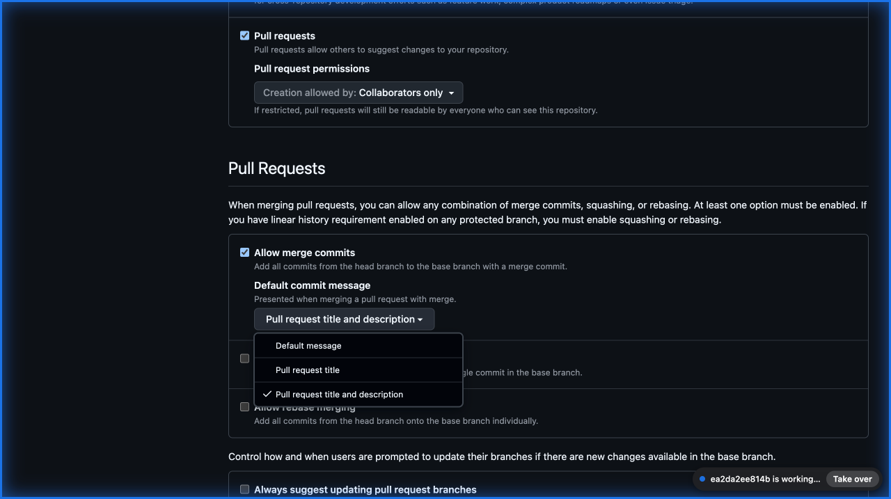

# Optional GitHub repository rules

[GitHub documentation](../README.md) · [Actions guides](../actions/README.md) · [Shared GitHub setup](../actions/setup.md)

These generic, browser-first guides configure optional GitHub policies alongside a git-tools workflow. They are **not a git-tools CLI command** and are not installed by `git-tools init`.

Use your own repository, eligible reviewers, permitted mergers, and dedicated automation account. The examples target `develop` and `master`; adapt the scope deliberately. Public visibility does not grant merge access. Screenshots illustrate GitHub's UI, not account names or a policy automatically applied to your repository.

## Policies

| Policy | What it controls |
| --- | --- |
| [1. PR-only](01-pr-only.md) | Human changes use PRs; the concrete Classic example allows merge commits only |
| [2. History protection](02-history-protection.md) | No deletion or force-push bypass, including for automation |
| [3. Independent review](03-independent-review.md) | Optional: an eligible code owner other than the author must approve |
| [4. Allowed mergers](04-allowed-mergers.md) | Restrict protected-branch merging to an explicit human allowlist, with a deliberate automation exception |

### Solo-developer and team presets

- **Solo developer: 1, 2, and 4.** Keep required approvals at **0**. The maintainer uses a PR and is the only permitted human merger. No independent approval is required for this preset.
- **Team requiring independent review: 1, 2, 3, and 4.** Prepare eligible reviewers and CODEOWNERS before activating policy 3. An allowed merger still needs the required review.

Policy 4 controls **who may merge**, not whether review is required. Under the solo preset, the permitted maintainer can merge their own PR without a review. Do not describe zero approvals or the merger allowlist as mandatory self-review.

*Saved example of the solo preset's three rulesets. The separate independent-review screenshot is an unsaved illustration, not an active fourth policy.*

## Before changing settings

- Inspect existing rulesets and classic branch protections. Overlapping requirements apply together; bypassing one does not bypass another. Edit an existing policy intentionally rather than creating duplicates.
- For policy 3, keep another eligible reviewer available: GitHub authors cannot approve their own PRs. Install valid CODEOWNERS on **both target branches** first.
- Confirm that the automation push credential authenticates as the intended bypass account. Commit author name/email and generic token write permission do not establish that identity. Never expose private keys in screenshots.
- Exact `develop`/`master` targets do not cover tags, `release/*`, `hotfix/*`, or every branch used by every mode. Review other scope separately.
- Merge-only is the concrete Classic preset, not a universal requirement. The [mode guides](../actions/README.md#choose-a-flow) retain their squash-based flows and ancestry-preserving synchronization exceptions.

## Common browser steps

### Open a new branch ruleset

1. Open the repository's **Settings**.
2. In the sidebar, expand **Rulesets**, then click **Rulesets**.
3. Choose **New ruleset → New branch ruleset**, not a tag ruleset.
4. Enter the guide's **Ruleset Name**.
5. Keep **Enforcement status → Disabled** while drafting; choose **Active** only when ready for an authorised rollout.

New forms currently preselect **Restrict deletions** and **Block force pushes**. Optional PR settings can also have preselected values. Follow the explicit selections rather than assuming an empty form.

### Target the exact branches

Repeat in each ruleset:

1. Under **Target branches**, choose **Add target → Include by pattern**.
2. Enter `develop` in **Branch naming pattern**.
3. Click **Add Inclusion pattern**.
4. Repeat with `master`.
5. Confirm exactly **Include: develop** and **Include: master**, with no exclusions.

Do not substitute **Include default branch** or **Include all branches**. API equivalents are `refs/heads/develop` and `refs/heads/master`. New rulesets use **Create**; existing ones use **Save changes**. Do not save a screenshot-only draft.

## Merge commit title and description

This is a repository **General setting**, not another branch ruleset.

For the merge-only Classic preset:

1. Open **Settings → General** and scroll to **Pull Requests**.
2. Check **Allow merge commits**.
3. Under **Default commit message**, choose **Pull request title and description**.
4. Leave **Allow squash merging** and **Allow rebase merging** unchecked for this preset only. A squash-based mode needs its own merge settings.
5. When completing a PR with **Create a merge commit**, inspect the proposed subject and body before confirming.

*The selected default is **Pull request title and description**. This is a message default, not a title-validation rule, review requirement, or permission grant.*

*The expanded menu shows which text GitHub will use. Opening the menu does not change or save the setting.*

| PR field | Merge commit field | GitHub API value |
| --- | --- | --- |
| PR title, for example `fix: correct version calculation` | Commit subject/title | `merge_commit_title: PR_TITLE` |
| PR description | Commit body/description | `merge_commit_message: PR_BODY` |

Use the final Conventional Commit or control title required by your [flow](../../git-flow-guide.md#pr-titles-drive-versioning), rather than relying on the generic `Merge pull request #...` subject. The merger can still edit the proposed message; verify it at merge time. These screenshots show repository settings, not a completed PR merge.

## Human review and the bot exception

The automation exception is deliberate and separate from human merger eligibility:

| Policy | Automation bypass in this example |
| --- | --- |
| 1. PR-only | Dedicated automation account → **Always allow** |
| 2. History protection | **None** |
| 3. Independent review, if enabled | Dedicated automation account → **Always allow**, if required for direct publication |
| 4. Allowed mergers | Dedicated automation account → **Always allow** |

**Always allow is identity-based.** It is not restricted to version commits, signed commits, or direct pushes. A bot with review bypass can also merge PRs without the human review requirement. Do not claim every merge is independently reviewed when this exception exists. Administrators can change the policy itself; it is not an immutable boundary against repository owners.

## Safe activation and verification

1. Keep PR-only and history rules separate so publication exceptions never waive history protection.
2. Apply the solo preset without policy 3, or prepare CODEOWNERS and another eligible reviewer before adding independent review for a team.
3. Configure policy 4 with the smallest intended human merger allowlist, using **Users → Exempt** only in that update-eligibility layer, plus the explicitly authorised automation account using **Always allow**. Keep those humans out of the PR, review, and history bypass lists so the other layers still apply. PR-only human bypass in policy 4 can instead leave ordinary PR merges behind a blocked-update/bypass confirmation. Do not add broad role or unrelated App bypasses.
4. Verify exact targets, actors, enabled rules, and enforcement status in the saved configuration.
5. Use suitable test PRs to confirm allowed and disallowed mergers. If policy 3 is enabled, also confirm that missing/stale approval blocks merging and a valid independent approval permits it.
6. Validate the automation credential and normal publication separately. Do not force-push or delete important branches merely to demonstrate protection.

Screenshots and API reads confirm configuration, not successful or rejected operations. These documentation changes do not change hosted settings, deploy a sign-off service, or modify collaborators.

## CLI baseline recipe

The [CLI setup recipe](branch-rulesets.md) stages, verifies, and activates only policies 1 and 2. It does not install independent review or the merger allowlist. Choose the relevant browser guide for those optional policies.

## GitHub references

- [Creating rulesets and selecting bypass modes](https://docs.github.com/en/repositories/configuring-branches-and-merges-in-your-repository/managing-rulesets/creating-rulesets-for-a-repository)
- [Available rules](https://docs.github.com/en/repositories/configuring-branches-and-merges-in-your-repository/managing-rulesets/available-rules-for-rulesets)
- [About code owners](https://docs.github.com/en/repositories/managing-your-repositorys-settings-and-features/customizing-your-repository/about-code-owners)
